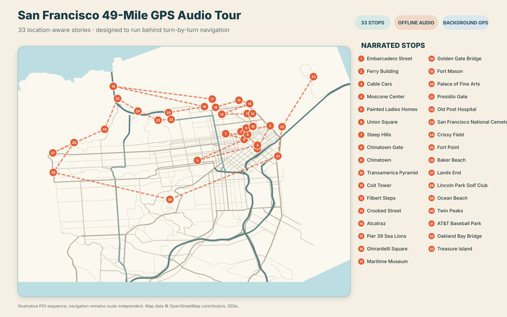
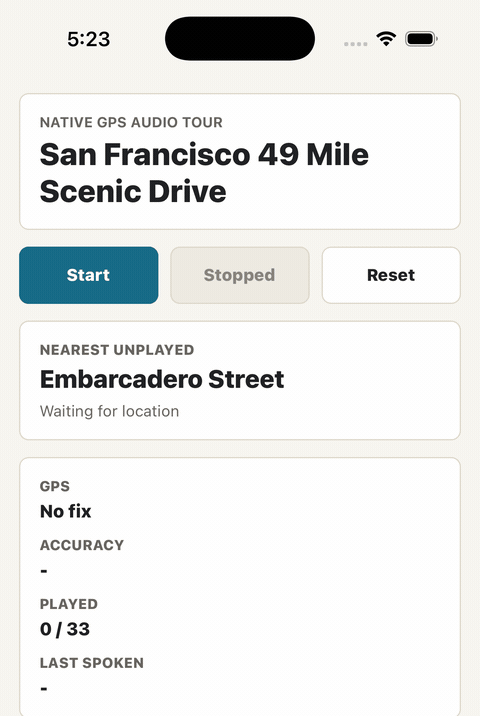
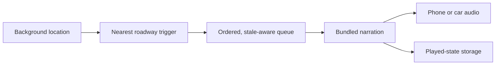

# San Francisco 49-Mile GPS Audio Tour

An iOS driving companion that plays location-aware stories while the driver's navigation app stays in the foreground.



The tour covers 33 San Francisco landmarks. Each stop uses several trigger points snapped to nearby drivable roads, so narration works across different approaches instead of depending on one perfect route.

## Demo

<p align="center">
  
</p>

The built-in demo queues three real narrations without requesting location access. After installing, tap **Play 3-Stop Demo**.

Listen to the same bundled samples directly:

- [Ferry Building](assets/narration/ferry-building.mp3)
- [Golden Gate Bridge](assets/narration/golden-gate-bridge.mp3)
- [Twin Peaks](assets/narration/twin-peaks.mp3)

## What it demonstrates

- Background GPS updates while Google Maps or another navigation app is visible
- Multiple roadway anchors for every point of interest
- Route-independent triggering: any nearby unplayed stop can announce
- An ordered queue for overlapping landmarks, with stale-item removal after the car moves away
- Offline, pre-rendered narration with no API keys in the app
- Persistent played state, reset controls, and live nearest-stop telemetry
- A native iOS audio session that mixes narration with music and navigation audio

## How it works



The landmark coordinate is descriptive. Activation uses two to four independently validated roadway coordinates, normally within 150–250 meters of the landmark. Crossing any anchor's 400-meter radius queues that stop once. The full trigger-generation and validation process is documented in [POI_TRIGGER_PIPELINE.md](POI_TRIGGER_PIPELINE.md).

Location and listening state remain on the device. The app has no account system, analytics service, or runtime network dependency.

## Install on an iPhone with Xcode

### Requirements

- A Mac with a current Xcode installation
- Node.js 18 or newer
- CocoaPods 1.14.3
- An iPhone with Developer Mode enabled
- Any Apple ID added to Xcode; a free personal development team is sufficient for a private install, although its provisioning expires after seven days

### 1. Clone and install dependencies

```sh
git clone https://github.com/adityasudhakar/mv-native-audio-tour.git
cd mv-native-audio-tour
npm ci
gem install cocoapods -v 1.14.3
npm run pods
```

`npm ci` applies the compatibility patches needed by this Expo 48 / React Native 0.71 project on current Xcode versions.

### 2. Open and sign the native project

```sh
open ios/MVAudioTour.xcworkspace
```

In Xcode:

1. Select the `MVAudioTour` project and `MVAudioTour` target.
2. Open **Signing & Capabilities**.
3. Enable automatic signing and select your personal team.
4. If Xcode reports that the bundle identifier is unavailable, change it to something unique, such as `com.yourname.mvaudiotour`.
5. Connect and unlock your iPhone, trust the Mac, and select the phone as the run destination.
6. Press **Run**.

For an install that works away from Metro and the Mac, edit the Xcode scheme and set **Run → Build Configuration** to `Release` before pressing Run. The Release build embeds its JavaScript bundle and all 33 MP3 files.

On first launch, tap **Start**, grant foreground location access, then grant **Always** access when iOS requests background permission. Do not force-quit the app during a tour; iOS stops continuous background location after a manual force-quit.

### Simulator preview

The three-stop demo works in the iOS Simulator and does not need simulated GPS. Background-location behavior should be evaluated on a physical iPhone.

```sh
npm start
```

Then run the `MVAudioTour` scheme on an iPhone simulator from Xcode and tap **Play 3-Stop Demo**.

## Project structure

| Path | Purpose |
| --- | --- |
| `App.tsx` | Tour controls, telemetry, route list, and demo UI |
| `src/route.ts` | 33 stops, narration copy, trigger coordinates, and bundled audio |
| `src/triggerEngine.ts` | Distance calculations, trigger selection, and stale-queue filtering |
| `src/backgroundTask.ts` | Background location task, narration queue, and playback lifecycle |
| `src/storage.ts` | Persistent played state and runtime snapshots |
| `assets/narration/` | Offline MP3 narration for every stop |
| `ios/` | Native Xcode project, permissions, audio session, and CocoaPods lockfile |

## Validation

```sh
npm run typecheck
```

The project has been compiled with Xcode 26.6 and exercised on a physical iPhone with Google Maps in the foreground. Background narration and route-independent triggering were confirmed during a drive test. Audio priority when music and navigation prompts overlap can still vary by vehicle and iOS audio route.

## Map attribution

The repository map is generated from the app's route data and public OpenStreetMap geometry. Map data © [OpenStreetMap contributors](https://www.openstreetmap.org/copyright), available under the Open Database License. The dashed line communicates POI sequence rather than turn-by-turn directions.
